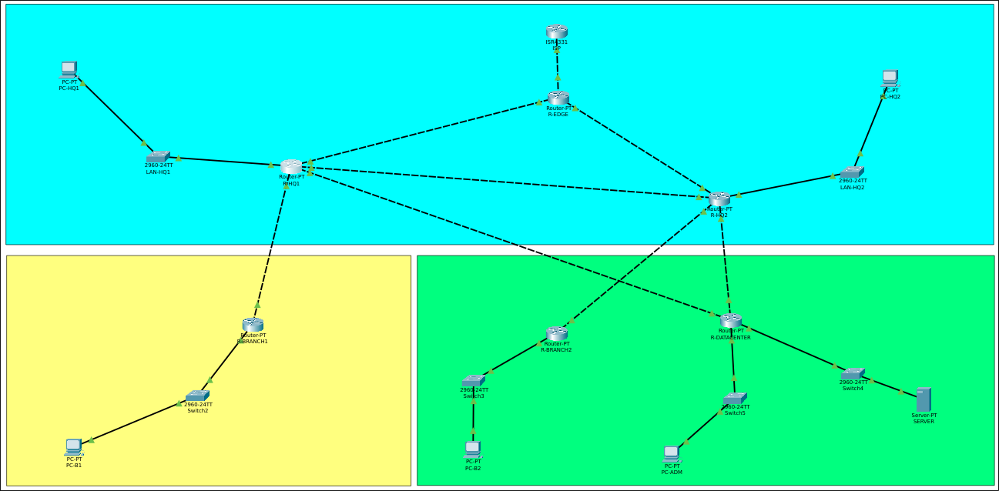

# Proyecto Integrador — Enrutamiento estático, RIPv2, OSPF e IA aplicada

|Nombre                        |     carnet|
|------------------------------|-----------|
|Juan José Gerardi Hernandez   | 201900532 |
|José Manuel Estrada Gutiérres | 201907078 |

**Curso:** Redes de Computadoras 2 — USAC
**Herramienta:** Cisco Packet Tracer
**Valor de D:** 8

---

## 1. Resumen del escenario

TecnoRed Guatemala, S.A. combina rutas estáticas, una sucursal heredada con RIPv2 (R-BRANCH1) y un núcleo corporativo en OSPF área 0. En este proyecto se integraron ambos dominios de enrutamiento, se configuró una ruta por defecto, una ruta estática específica y una flotante, se ajustaron los costos OSPF para tener un camino principal y uno de respaldo, y se usó un asistente de IA como apoyo de diagnóstico, validando sus recomendaciones en la topología.

## 2. Topología



| Dominio | Routers |
|---|---|
| OSPF área 0 | R-EDGE, R-HQ1, R-HQ2, R-BRANCH2, R-DATACENTER |
| RIPv2 | R-BRANCH1 |
| Punto de integración | R-HQ1 (redistribución RIP ↔ OSPF) |
| Internet | R-ISP |

---

## 3. Plan de direccionamiento (D = 8)

### 3.1 Enlaces WAN

| Enlace | Red | Extremo A | Extremo B |
|---|---|---|---|
| R-EDGE – R-ISP | 200.10.8.0/30 | R-ISP `.1` | R-EDGE `.2` |
| R-EDGE – R-HQ1 | 10.8.2.0/30 | R-EDGE `.1` | R-HQ1 `.2` |
| R-EDGE – R-HQ2 | 10.8.3.0/30 | R-EDGE `.1` | R-HQ2 `.2` |
| R-HQ1 – R-HQ2 | 10.8.1.0/30 | R-HQ1 `.1` | R-HQ2 `.2` |
| R-HQ1 – R-BRANCH1 | 10.8.12.0/30 | R-HQ1 `.1` | R-BRANCH1 `.2` |
| R-HQ2 – R-BRANCH2 | 10.8.23.0/30 | R-HQ2 `.1` | R-BRANCH2 `.2` |
| R-HQ2 – R-DATACENTER | 10.8.30.0/30 | R-HQ2 `.1` | R-DATACENTER `.2` |
| R-HQ1 – R-DATACENTER (redundante) | 10.8.4.0/30 | R-HQ1 `.1` | R-DATACENTER `.2` |

Máscara de todos los enlaces: `255.255.255.252`. Las subredes EDGE–HQ1, EDGE–HQ2 y HQ1–DATACENTER no aparecen en la tabla base del enunciado, por lo que se definieron como `10.8.2.0/30`, `10.8.3.0/30` y `10.8.4.0/30`.

### 3.2 Redes LAN

| LAN | Red | Gateway | Host final |
|---|---|---|---|
| LAN HQ1 | 192.168.108.0/24 | 192.168.108.1 (R-HQ1) | PC-HQ1 `192.168.108.10` |
| LAN HQ2 | 192.168.118.0/24 | 192.168.118.1 (R-HQ2) | PC-HQ2 `192.168.118.10` |
| LAN BRANCH1 | 192.168.8.0/24 | 192.168.8.1 (R-BRANCH1) | PC-B1 `192.168.8.10` |
| LAN BRANCH2 | 192.168.28.0/24 | 192.168.28.1 (R-BRANCH2) | PC-B2 `192.168.28.10` |
| Servidores | 172.16.8.0/24 | 172.16.8.1 (R-DATACENTER) | SERVER `172.16.8.10` |
| Admin | 172.20.8.0/24 | 172.20.8.1 (R-DATACENTER) | PC-ADMIN `172.20.8.10` |

Máscara de todas las LAN: `255.255.255.0`.

### 3.3 Tabla de IPs por dispositivo e interfaz

| Dispositivo | Interfaz | IP | Máscara | Conecta a |
|---|---|---|---|---|
| R-ISP | Gi0/0/0 | 200.10.8.1 | 255.255.255.252 | R-EDGE |
| R-EDGE | Gi6/0 | 200.10.8.2 | 255.255.255.252 | R-ISP |
| R-EDGE | Gi7/0 | 10.8.2.1 | 255.255.255.252 | R-HQ1 |
| R-EDGE | Gi8/0 | 10.8.3.1 | 255.255.255.252 | R-HQ2 |
| R-HQ1 | Fa0/0 | 10.8.1.1 | 255.255.255.252 | R-HQ2 |
| R-HQ1 | Gi6/0 | 10.8.2.2 | 255.255.255.252 | R-EDGE |
| R-HQ1 | Gi7/0 | 10.8.12.1 | 255.255.255.252 | R-BRANCH1 |
| R-HQ1 | Gi8/0 | 192.168.108.1 | 255.255.255.0 | LAN HQ1 |
| R-HQ1 | Gi9/0 | 10.8.4.1 | 255.255.255.252 | R-DATACENTER (redundante) |
| R-HQ2 | Fa0/0 | 10.8.1.2 | 255.255.255.252 | R-HQ1 |
| R-HQ2 | Gi6/0 | 10.8.3.2 | 255.255.255.252 | R-EDGE |
| R-HQ2 | — | 10.8.23.1 | 255.255.255.252 | R-BRANCH2 |
| R-HQ2 | — | 10.8.30.1 | 255.255.255.252 | R-DATACENTER |
| R-HQ2 | — | 192.168.118.1 | 255.255.255.0 | LAN HQ2 |
| R-BRANCH1 | Gi6/0 | 10.8.12.2 | 255.255.255.252 | R-HQ1 |
| R-BRANCH1 | Gi7/0 | 192.168.8.1 | 255.255.255.0 | LAN BRANCH1 |
| R-BRANCH2 | Gi6/0 | 10.8.23.2 | 255.255.255.252 | R-HQ2 |
| R-BRANCH2 | Gi7/0 | 192.168.28.1 | 255.255.255.0 | LAN BRANCH2 |
| R-DATACENTER | Gi6/0 | 10.8.4.2 | 255.255.255.252 | R-HQ1 (redundante) |
| R-DATACENTER | Gi7/0 | 10.8.30.2 | 255.255.255.252 | R-HQ2 |
| R-DATACENTER | — | 172.16.8.1 | 255.255.255.0 | LAN Servidores |
| R-DATACENTER | — | 172.20.8.1 | 255.255.255.0 | LAN Admin |

---

## 4. Fase I — Construcción, cableado y direccionamiento

Se asignó hostname a los siete routers, se configuraron las interfaces con las IPs de la tabla 3.3, se agregó `description` en cada enlace WAN y LAN, se activaron con `no shutdown`, y se configuró IP, máscara y gateway en los equipos finales. Antes de activar cualquier protocolo se comprobó la conectividad entre vecinos directos con `ping`.

**Incidencia durante la fase:** en R-BRANCH1, R-BRANCH2 y R-DATACENTER la IP de la LAN estaba configurada en una interfaz `FastEthernet` sin cable (`down/down`), mientras que el cable estaba conectado a una `GigabitEthernet` sin IP (`up/up`). Se identificó con `show ip interface brief`, se movió la configuración a la interfaz con cable y se dejó la interfaz anterior sin IP y en `shutdown`.

**Evidencia — `show ip interface brief`:**

- `[CAPTURA R-HQ1]`

- `[CAPTURA R-HQ2]`

- `[CAPTURA R-BRANCH1]`

- `[CAPTURA R-BRANCH2]`

- `[CAPTURA R-DATACENTER]`


**Evidencia — ping a vecinos directos y de cada PC a su gateway:**


---

## 5. Fase II — Enrutamiento estático

### 5.1 Ruta por defecto

En **R-EDGE**:

```
ip route 0.0.0.0 0.0.0.0 200.10.8.1
router ospf 10
 default-information originate
```

En **R-ISP**, rutas de regreso hacia la red interna (resumidas):

```
ip route 10.8.0.0 255.255.0.0 200.10.8.2
ip route 192.168.0.0 255.255.0.0 200.10.8.2
ip route 172.16.0.0 255.240.0.0 200.10.8.2
```

R-EDGE tiene la ruta por defecto como estática (`S*`, AD 1) y la anuncia por OSPF como ruta externa tipo 2. R-HQ1 la redistribuye hacia RIP, y R-BRANCH1 la aprende como `R*`. De esta forma no fue necesario configurar una estática en cada router.

**Evidencias:**

- `show ip route` de R-EDGE: `S* 0.0.0.0/0 [1/0] via 200.10.8.1`.

- `show ip route 0.0.0.0` de R-HQ2: `O*E2`, aprendida desde 3.3.3.3 vía 10.8.3.1.

- `show ip route 0.0.0.0` de R-BRANCH1: `R*`, métrica 2, vía 10.8.12.1.

- `show ip route` de R-ISP con las rutas `S` de regreso.

- Ping de PC-HQ1 y de PC-B1 a `200.10.8.1`.


### 5.2 Ruta estática específica

En **R-HQ2** se configuró una ruta estática hacia la red de administración a través de R-DATACENTER:

```
ip route 172.20.8.0 255.255.255.0 10.8.30.2
```

`show ip route 172.20.8.0` muestra `Known via "static", distance 1, metric 0`, con next-hop `10.8.30.2`. 


### 5.3 Ruta estática flotante

En **R-HQ2**, para la misma red, se configuró una ruta de respaldo por R-HQ1 con distancia administrativa 130:

```
ip route 172.20.8.0 255.255.255.0 10.8.1.1 130
```


### 5.4 Análisis

La red `172.20.8.0/24` es alcanzable desde R-HQ2 por tres mecanismos distintos:

| Mecanismo | AD | Estado |
|---|---|---|
| Estática vía 10.8.30.2 | 1 | Instalada |
| OSPF | 110 | Alternativa, no instalada |
| Estática flotante vía 10.8.1.1 | 130 | Respaldo, no instalada |

El router instala únicamente la ruta de menor distancia administrativa para un mismo prefijo, ya que la AD mide la confiabilidad de la fuente de la ruta. Por eso la flotante no aparece en la tabla mientras exista una ruta con menor AD. Además, como OSPF (110) también es menor que 130, la flotante solo se instalaría si desaparecen tanto la estática principal como la ruta OSPF.

### 5.5 Prueba de activación de la ruta flotante

| Momento | Acción | Comportamiento esperado |
|---|---|---|
| 1 | Estado normal | Se instala la estática de AD 1 vía 10.8.30.2 |
| 2 | `shutdown` de la interfaz de R-HQ2 hacia R-DATACENTER | Desaparece la estática y OSPF (AD 110) toma el relevo vía 10.8.1.1 |
| 3 | `passive-interface default` bajo `router ospf 10` en R-HQ2 y esperar la caída de los vecinos | Sin ruta OSPF, se instala la flotante (AD 130) vía 10.8.1.1 |
| 4 | Restaurar (`no passive-interface default` y `no shutdown`) | Vuelve a instalarse la estática de AD 1 |

En el momento 3, R-HQ2 deja de intercambiar OSPF, por lo que R-HQ1 y R-EDGE pierden la ruta hacia `192.168.118.0/24`. Esa prueba se usó solo para observar la tabla de enrutamiento, no para medir conectividad.

---

## 6. Fase III — RIPv2 en la sucursal norte

En **R-BRANCH1**:

```
router rip
 version 2
 no auto-summary
 network 10.0.0.0
 network 192.168.8.0
```

**Análisis:**

- RIP usa como métrica el conteo de saltos (hop count). El máximo es 15 saltos, y una métrica de 16 se considera destino inalcanzable.
- Las redes de la sucursal se anuncian hacia el núcleo desde **R-HQ1**, que es el vecino RIP de R-BRANCH1 y tiene interfaces en ambos dominios.
- `no auto-summary` evita que RIP resuma las redes a su clase mayor (por ejemplo `10.0.0.0/8`) y hace que anuncie las subredes reales `/24` y `/30`.

---

## 7. Fase IV — OSPF en el núcleo

El proceso es `router ospf 10`, en área única (área 0), en R-EDGE, R-HQ1, R-HQ2, R-BRANCH2 y R-DATACENTER. El enlace R-HQ1 – R-BRANCH1 (`10.8.12.0/30`) no pertenece a OSPF, porque es parte del dominio RIP.

| Router | Router ID |
|---|---|
| R-HQ1 | 1.1.1.1 |
| R-HQ2 | 2.2.2.2 |
| R-EDGE | 3.3.3.3 |
| R-BRANCH2 | 4.4.4.4 |
| R-DATACENTER | 5.5.5.5 |


---

## 8. Fase V — Integración entre RIPv2 y OSPF

### 8.1 Decisión de diseño

El punto de integración es **R-HQ1**, porque es el único router con interfaces en ambos dominios: Gi7/0 hacia RIP y el resto hacia OSPF. Se implementó **redistribución mutua** en ese único punto. Esto evita bucles de enrutamiento y evita configurar una ruta estática por cada red.

### 8.2 Configuración en R-HQ1

```
router rip
 version 2
 redistribute ospf 10 metric 2
 network 10.0.0.0
 no auto-summary

router ospf 10
 redistribute rip subnets
```

- `metric 2` es obligatorio al redistribuir hacia RIP; sin métrica, RIP considera las rutas inalcanzables.
- `subnets` es necesario para que OSPF redistribuya las subredes, ya que sin esa palabra solo pasan redes con máscara de clase.
- En `show ip protocols` de R-HQ1, RIP envía y recibe solo por Gi7/0 (hacia BRANCH1); las demás interfaces aparecen como pasivas.

### 8.3 Verificación

| Prueba | Resultado |
|---|---|---|
| `show ip route 192.168.8.0` en R-HQ2 | Ruta aprendida por OSPF desde 1.1.1.1, métrica 20 | 
| `show ip route` en R-EDGE | `O E2 192.168.8.0/24 [110/20]` y `O E2 10.8.12.0/30 [110/20]` |
| `show ip route` en R-BRANCH1 | Rutas `R` hacia 192.168.108.0, 192.168.118.0, 192.168.28.0, 172.16.8.0 y 172.20.8.0, vía 10.8.12.1 |
| Ping PC-HQ1 – PC-B1 | Responde |
| Ping PC-B1 – SERVER | Responde |
| `tracert` PC-B1 – SERVER | Camino por R-HQ1 hacia el núcleo |

### 8.4 Distancia administrativa y métrica

- La **distancia administrativa** decide qué protocolo o fuente gana cuando el mismo prefijo llega por varios mecanismos: estática 1, OSPF 110, RIP 120 y estática flotante 130.
- La **métrica** decide entre rutas del mismo protocolo: saltos en RIP y costo en OSPF. Las métricas de protocolos distintos no se comparan entre sí.
- En R-BRANCH1 las rutas redistribuidas aparecen con métrica 2 porque ese es el valor fijado en `redistribute ospf 10 metric 2`, y no la distancia real en saltos.
- Redes alcanzables por más de un mecanismo: `192.168.8.0/24` (RIP en R-HQ1 y OSPF externa tipo 2 en el resto del núcleo) y `172.20.8.0/24` (estática, OSPF y flotante en R-HQ2).

---

## 9. Fase VI — Redundancia, costos y simulación de falla

### 9.1 Estado inicial

El enlace redundante R-HQ1 – R-DATACENTER (`10.8.4.0/30`) se habilitó y, al tener el mismo costo que los demás enlaces, OSPF repartía el tráfico por dos caminos iguales (ECMP) hacia `172.16.8.0/24` y `172.20.8.0/24`.

### 9.2 Ajuste de costos

Para que el enlace redundante quede solo como respaldo, se configuró un costo de 50 en ambos extremos:

En **R-HQ1**:

```
interface gigabitEthernet 9/0
 ip ospf cost 50
```

En **R-DATACENTER**:

```
interface gigabitEthernet 6/0
 ip ospf cost 50
```

### 9.3 Camino principal

En R-HQ1, `show ip route 172.16.8.0` indica:

```
Routing entry for 172.16.8.0/24
Known via "ospf 10", distance 110, metric 3, type intra area
Last update from 10.8.1.2 on FastEthernet0/0
```

El camino principal pasa por R-HQ2 (`10.8.1.2`) con métrica 3, que es la suma de los costos de las interfaces de salida: HQ1 → HQ2 (1), HQ2 → DATACENTER (1) y DATACENTER → LAN de servidores (1). El camino por el enlace redundante costaría 50 + 1 = 51, por lo que no se elige mientras el principal esté disponible.


### 9.4 Falla controlada y recuperación

Procedimiento:

1. Registrar la ruta usada antes de la falla (9.3).
2. Aplicar `shutdown` a la interfaz de R-HQ2 que va a R-DATACENTER.
3. Verificar en R-DATACENTER con `show ip ospf neighbor` la pérdida del vecino 2.2.2.2.
4. Verificar en R-HQ1 con `show ip route 172.16.8.0` el cambio de ruta hacia el enlace redundante (`10.8.4.2`, por Gi9/0).
5. Medir el nuevo camino con `tracert 172.16.8.10` desde PC-HQ1.
6. Restaurar con `no shutdown` y comprobar que la ruta vuelve al camino principal.


---

## 10. Fase VII — IA aplicada al enrutamiento (AI Routing Advisor)

**Herramienta de IA utilizada:** Claude (Anthropic).

**Prompt enviado:**

> Analiza las siguientes salidas de Cisco IOS. Identifica rutas OSPF, RIP y estáticas; determina la ruta seleccionada hacia la red de servidores, explica la razón usando distancia administrativa y métrica, identifica una posible falla y propone comandos adicionales para confirmar el diagnóstico.

**Evidencia entregada a la IA:** `show ip route`, `show ip protocols`, `show ip ospf neighbor` y `show ip interface brief` de R-HQ1, tomadas con la red en estado normal.


```
R-HQ1#show ip route 
Codes: C - connected, S - static, I - IGRP, R - RIP, M - mobile, B - BGP
       D - EIGRP, EX - EIGRP external, O - OSPF, IA - OSPF inter area
       N1 - OSPF NSSA external type 1, N2 - OSPF NSSA external type 2
       E1 - OSPF external type 1, E2 - OSPF external type 2, E - EGP
       i - IS-IS, L1 - IS-IS level-1, L2 - IS-IS level-2, ia - IS-IS inter area
       * - candidate default, U - per-user static route, o - ODR
       P - periodic downloaded static route

Gateway of last resort is 10.8.2.1 to network 0.0.0.0

     10.0.0.0/30 is subnetted, 7 subnets
C       10.8.1.0 is directly connected, FastEthernet0/0
C       10.8.2.0 is directly connected, GigabitEthernet6/0
O       10.8.3.0 [110/2] via 10.8.2.1, 04:16:27, GigabitEthernet6/0
                 [110/2] via 10.8.1.2, 04:16:27, FastEthernet0/0
C       10.8.4.0 is directly connected, GigabitEthernet9/0
C       10.8.12.0 is directly connected, GigabitEthernet7/0
O       10.8.23.0 [110/2] via 10.8.1.2, 04:16:27, FastEthernet0/0
O       10.8.30.0 [110/2] via 10.8.1.2, 00:05:02, FastEthernet0/0
     172.16.0.0/24 is subnetted, 1 subnets
O       172.16.8.0 [110/3] via 10.8.1.2, 00:05:02, FastEthernet0/0
     172.20.0.0/24 is subnetted, 1 subnets

R-HQ1#h
R-HQ1#s
R-HQ1#sh
R-HQ1#show ip pr
R-HQ1#show ip protocols 
Routing Protocol is "rip"
Sending updates every 30 seconds, next due in 14 seconds
Invalid after 180 seconds, hold down 180, flushed after 240
Outgoing update filter list for all interfaces is not set
Incoming update filter list for all interfaces is not set
Redistributing: rip, ospf 10 
Default version control: send version 2, receive 2
  Interface             Send  Recv  Triggered RIP  Key-chain
  GigabitEthernet7/0    22
Automatic network summarization is not in effect
Maximum path: 4
Routing for Networks:
	10.0.0.0
Passive Interface(s):
	FastEthernet0/0
	FastEthernet1/0
	Serial2/0
	Serial3/0
	FastEthernet4/0
	FastEthernet5/0
	GigabitEthernet6/0
	GigabitEthernet8/0

R-HQ1#h
R-HQ1#ho
R-HQ1#sh
R-HQ1#show ip os
R-HQ1#show ip ospf ne
R-HQ1#show ip ospf neighbor 


Neighbor ID     Pri   State           Dead Time   Address         Interface
2.2.2.2           1   FULL/DR         00:00:38    10.8.1.2        FastEthernet0/0
3.3.3.3           1   FULL/DR         00:00:38    10.8.2.1        GigabitEthernet6/0
5.5.5.5           1   FULL/DR         00:00:38    10.8.4.2        GigabitEthernet9/0
R-HQ1#sh
R-HQ1#show ip inter
R-HQ1#show ip interface b
R-HQ1#show ip interface brief 
Interface              IP-Address      OK? Method Status                Protocol 
FastEthernet0/0        10.8.1.1        YES manual up                    up 
FastEthernet1/0        unassigned      YES unset  administratively down down 
Serial2/0              unassigned      YES unset  administratively down down 
Serial3/0              unassigned      YES unset  administratively down down 
FastEthernet4/0        unassigned      YES unset  administratively down down 
FastEthernet5/0        unassigned      YES unset  administratively down down 
GigabitEthernet6/0     10.8.2.2        YES manual up                    up 
GigabitEthernet7/0     10.8.12.1       YES manual up                    up 
GigabitEthernet8/0     192.168.108.1   YES manual up                    up 
GigabitE


Analiza las siguientes salidas de Cisco IOS. Identifica rutas OSPF, RIP y estáticas; determina la ruta seleccionada hacia la red de servidores, explica la razón usando distancia administrativa y métrica, identifica una posible falla y propone comandos adicionales para confirmar el diagnóstico.
``` 

**Respuesta de la IA (resumen):**

- *Rutas identificadas:* conectadas (`C`) en 10.8.1.0, 10.8.2.0, 10.8.4.0 y 10.8.12.0; OSPF (`O`) en 10.8.3.0, 10.8.23.0, 10.8.30.0 y 172.16.8.0; sin rutas estáticas en R-HQ1; rutas RIP no visibles porque la salida llegó cortada.
- *Ruta hacia 172.16.8.0/24:* OSPF `[110/3]` vía 10.8.1.2 (R-HQ2). La distancia administrativa no decide aquí porque OSPF es la única fuente de ese prefijo; la métrica decide entre dos caminos OSPF: 1+1+1 = 3 por R-HQ2 contra 50+1 = 51 por el enlace redundante.
- *Limitación señalada:* la evidencia corresponde al estado normal, no a una falla, y tres salidas estaban incompletas.
- *Hipótesis de falla (de más a menos probable):*
  1. Costo asimétrico en el enlace redundante, si `ip ospf cost 50` está solo en R-HQ1 y no en R-DATACENTER.
  2. Costo igual (1) para interfaces FastEthernet y Gigabit por el `auto-cost reference-bandwidth` por defecto de 100 Mbps, aunque el camino principal pasa por un enlace FastEthernet.
  3. Inestabilidad (flapping) de alguna adyacencia OSPF.
  4. RIP activo en una interfaz hacia un vecino que solo usa OSPF.
- *Comandos propuestos para confirmar:* `show ip ospf interface gigabitEthernet 6/0` en R-DATACENTER y `show ip ospf interface gigabitEthernet 9/0` en R-HQ1; `show ip ospf interface brief`; `show ip protocols`; `show ip ospf neighbor` y `show logging` en R-HQ2 y R-DATACENTER; `show running-config | section router rip` en R-HQ1; `ping` y `tracert` durante la falla.
- *Corrección propuesta:* asegurar el mismo costo en ambos extremos del enlace redundante y, si procede, `auto-cost reference-bandwidth 1000` en todos los routers OSPF.

**Validación técnica en la topología:**

| Afirmación de la IA | Comando de verificación | Resultado | Veredicto |
|---|---|---|---|
| Ruta a 172.16.8.0/24 por OSPF vía 10.8.1.2 con métrica 3 | `show ip route 172.16.8.0` en R-HQ1 | La salida muestra `Known via "ospf 10"`, distancia 110, métrica 3, vía 10.8.1.2 por FastEthernet0/0. | Correcta |
| Costo 50 en ambos extremos del enlace redundante (posible asimetría) | `show ip ospf interface gigabitEthernet 6/0` en R-DATACENTER | **A:** R-DATACENTER muestra `Cost: 50`; ambos extremos coinciden y no hay asimetría. **B:** R-DATACENTER muestra `Cost: 1`; el costo solo estaba en R-HQ1, hay asimetría y se corrigió aplicando `ip ospf cost 50`. | **A:** Incorrecta (no había problema). **B:** Correcta |
| Mismo costo para FastEthernet y Gigabit por el ancho de banda de referencia | `show ip ospf interface brief` en R-HQ1 | **A:** Fa0/0 y las interfaces Gi aparecen con costo 1 (excepto Gi9/0 con 50), lo que confirma que OSPF no distingue entre ambos tipos de interfaz. **B:** Fa0/0 aparece con un costo mayor que las Gi, por lo que sí las distingue. | **A:** Correcta. **B:** Incorrecta |
| Adyacencias estables, sin flapping | `show ip ospf neighbor` y `show logging` en R-HQ2 y R-DATACENTER | **A:** Todos los vecinos están en `FULL` y el log no muestra cambios de estado recientes, salvo los provocados por la prueba de falla controlada. **B:** El log muestra cambios de estado (`FULL` a `DOWN` y de regreso) que no corresponden a la prueba. | **A:** Incorrecta (no había flapping). **B:** Correcta |
| RIP no activo hacia DATACENTER | `show running-config \| section router rip` en R-HQ1 | **A:** Solo Gi7/0 está sin `passive-interface`; Gi9/0 queda pasiva, por lo que no se envía RIP hacia DATACENTER. **B:** Gi9/0 no está pasiva; R-HQ1 sí envía actualizaciones RIP por ese enlace, sin vecino RIP al otro lado, y se corrigió con `passive-interface gigabitEthernet 9/0`. | **A:** Incorrecta. **B:** Correcta |


**Conclusión del caso de IA:** la IA interpretó correctamente los códigos de ruta, la distancia administrativa y la métrica de la ruta hacia la red de servidores. Sus hipótesis de falla son propuestas que se aceptan o descartan solo después de ejecutar los comandos de la tabla anterior. La IA no reemplaza a OSPF ni a la validación técnica del administrador: solo ayuda a formular hipótesis y a decidir qué comandos ejecutar.

---

## 11. Troubleshooting

La metodología fue la misma en todos los casos: capa física, direccionamiento IP, protocolo de enrutamiento y tabla de rutas.

| # | Síntoma | Diagnóstico | Corrección |
|---|---|---|---|
| 1 | PC-B1, PC-B2, SERVER y PC-ADMIN no hacían ping a su gateway | `show ip interface brief` mostró la IP en una interfaz `down/down` y el cable en otra interfaz `up/up` sin IP | Se movió la configuración de la LAN a la interfaz con cable |
| 2 | `Invalid next hop address (it's this router)` al crear la ruta por defecto | La ruta se escribió en R-ISP usando su propia IP como next-hop | Se aplicó la ruta por defecto en R-EDGE con next-hop `200.10.8.1` |
| 3 | PC-HQ1 no alcanzaba a PC-B1 antes de la Fase V | R-BRANCH1 no conocía `192.168.108.0/24` porque no había redistribución de OSPF a RIP | Se configuró la redistribución mutua en R-HQ1 |

---

## 12. Preguntas técnicas de defensa

**1. ¿Por qué OSPF es más adecuado para el núcleo que RIP?**
OSPF es un protocolo de estado de enlace: converge más rápido, no tiene el límite de 15 saltos, usa una métrica basada en el costo del enlace (ancho de banda) y envía actualizaciones solo cuando hay cambios. RIP se basa en saltos, converge lento y envía su tabla completa cada 30 segundos.

**2. ¿Qué métrica utiliza RIP y cuál es su límite?**
El conteo de saltos. El máximo es 15; 16 significa inalcanzable.

**3. ¿Qué representa el costo en OSPF?**
Qué tan costoso es salir por una interfaz, calculado por defecto como ancho de banda de referencia (100 Mbps) dividido entre el ancho de banda de la interfaz. La métrica de una ruta es la suma de los costos de las interfaces de salida del camino.

**4. ¿Cuál es la diferencia entre métrica y distancia administrativa?**
La AD indica qué tan confiable es la fuente de la ruta y decide qué protocolo gana para un mismo prefijo. La métrica decide el mejor camino dentro de un mismo protocolo. No se comparan métricas de protocolos distintos.

**5. ¿Por qué una ruta estática puede ser preferida a una ruta RIP?**
Porque la estática tiene AD 1 y RIP tiene AD 120. Con el mismo prefijo, gana la de menor AD sin importar la métrica.

**6. ¿Cómo se convierte una ruta estática en ruta flotante?**
Asignándole una AD mayor que la de la ruta principal, por ejemplo `ip route RED MASCARA NEXT-HOP 130`. Solo se instala cuando desaparecen las rutas con menor AD.

**7. ¿Qué ocurre cuando un vecino OSPF deja de estar disponible?**
Al vencer el dead interval (o al caer la interfaz) se elimina la adyacencia, se genera un nuevo LSA, los routers recalculan SPF y reconvergen hacia el camino alternativo, si existe.

**8. ¿Cómo se verifica una adyacencia OSPF?**
Con `show ip ospf neighbor`, donde el vecino debe estar en estado `FULL`. También con `show ip ospf interface brief`.

**9. ¿Qué función cumple `no auto-summary` en RIPv2?**
Evita que RIP resuma las subredes a su clase mayor en los límites de red, de modo que anuncia las subredes reales con su máscara.

**10. ¿Puede una IA reemplazar OSPF?**
No. OSPF es un protocolo que corre en los routers y calcula rutas automáticamente en tiempo real. La IA solo analiza salidas y sugiere diagnósticos; sus respuestas son hipótesis que el administrador debe validar.

**11. ¿Qué salidas de IOS son más útiles para diagnosticar una falla de enrutamiento?**
`show ip interface brief`, `show ip route`, `show ip protocols`, `show ip ospf neighbor`, `show running-config | section router`, `ping` y `tracert`.

**12. ¿Por qué una recomendación de IA debe validarse antes de aplicarse?**
Porque puede estar incompleta o equivocada, ya que no conoce la topología real ni ve el estado en vivo de la red, y aplicar un cambio sin verificar puede causar una caída.

---

## 13. Índice de evidencias

| # | Evidencia | Sección |
|---|---|---|
| 1 | Archivo `.pkt` con el carné en el nombre | Entrega |
| 2 | Topología completa con etiquetas de red | 2 |
| 3 | Tabla final de direccionamiento | 3 |
| 4 | `show ip interface brief` de los routers | 4 |
| 5 | `show ip route` de los routers principales | 5, 6, 7, 8, 9 |
| 6 | `show ip protocols` | 6, 7 |
| 7 | `show ip ospf neighbor` | 7 |
| 8 | Pruebas de ping entre LAN remotas | 8.3 |
| 9 | `tracert` hacia el Data Center | 9.3 y 9.4 |
| 10 | Evidencia de rutas RIPv2 | 6, 8.3 |
| 11 | Evidencia de rutas OSPF | 7, 8.3 |
| 12 | Ruta estática y ruta por defecto | 5.1 y 5.2 |
| 13 | Ruta estática flotante y prueba de activación | 5.3 y 5.5 |
| 14 | Prueba de falla y recuperación | 9.4 |
| 15 | Análisis realizado mediante IA | 10 |
| 16 | Validación técnica de la respuesta de IA | 10 |
| 17 | Conclusiones técnicas | 14 |

---

## 14. Conclusiones técnicas

- RIPv2, OSPF y las rutas estáticas pueden coexistir en una misma red cuando existe un punto claro de integración. En este proyecto fue R-HQ1, con redistribución mutua, lo que permitió conectividad entre todas las LAN sin una estática por cada red.
- La distancia administrativa y la métrica resuelven problemas distintos: la AD elige la fuente de la ruta (estática, OSPF, RIP) y la métrica elige el mejor camino dentro de un protocolo. Una ruta redistribuida puede mostrar una métrica que no refleja la distancia real, como las rutas con métrica 2 en R-BRANCH1.
- Las rutas estáticas flotantes sirven de respaldo solo si su AD es mayor que la de todas las demás fuentes de ese prefijo; como OSPF tiene AD 110, una flotante con AD 130 solo se activa cuando también desaparece la ruta OSPF.
- Ajustar el costo OSPF del enlace redundante a 50 lo dejó como camino alternativo y dejó el camino por R-HQ2 (métrica 3) como principal.
- La IA fue útil para interpretar las salidas de IOS y proponer hipótesis y comandos de verificación, pero sus recomendaciones solo se consideran válidas tras comprobarlas en la topología.